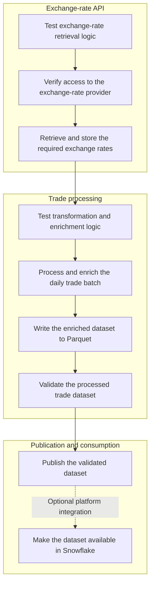

# Exercise 2 — Pipeline design

This document answers Part 2: Platform Engineering in `challenge.md`. It explains how Apache Airflow can automate the existing trade analytics application.

## Objective and scope

Use an Airflow DAG to run the daily trade pipeline. The DAG checks the exchange-rate component, gets the required USD exchange rates, processes the trades, writes the Parquet file, and validates the result.

Each task starts only after its upstream task succeeds. If a task fails, Airflow stops the downstream tasks. An operator can correct the problem and restart the failed task. The operator does not need to restart the complete DAG.

## Workflow

The diagram groups the Airflow tasks into three components. The exchange-rate tests and the live provider check form the first gate. They are separate tasks because only the provider check uses an external service. A failed task blocks downstream processing.

| Stage | Purpose |
| --- | --- |
| Test exchange-rate retrieval logic | Test rate parsing, date coverage, and error handling with mocked responses and temporary files. |
| Verify access to the exchange-rate provider | Confirm that the provider returns a usable response. |
| Retrieve and store the required exchange rates | Get the daily rates for the trade dates and store them for enrichment. |
| Test transformation and enrichment logic | Test data cleanup, data types, reference joins, and value calculations with isolated fixtures. |
| Process and enrich the daily trade batch | Read the trades and security references. Apply the exchange rates and prepare the enriched dataset. |
| Write the enriched dataset to Parquet | Write the prepared dataset to a candidate location. This separate task identifies file-write failures. |
| Validate the processed trade dataset | Run the final data-quality checks on the candidate output. |
| Publish the validated dataset | Make the approved dataset available to consumers. Keep the previous valid output if validation fails. |

Airflow runs the application commands and test suites. It captures their exit codes and fails a task when a command returns a nonzero exit code. The deployment must contain the application and its tests from the same revision.

## Scheduling, source arrival delays, failures and reruns

Airflow schedules the DAG for the expected end-of-day trade delivery. A deferrable or rescheduling sensor checks once per hour for the required daily source files. The sensor does not occupy a worker while it waits.

If the files are not available by a first "warning deadline", Airflow sends a notification, such as an email, and continues the hourly checks. If the files are still missing at the "critical deadline", the sensor fails. Airflow then sends a final alert with the business date and the names of the missing files. Processing starts when all required files are available.

An event-driven trigger is an alternative if the source platform can send a reliable file-arrival event. It is useful when the pipeline must start quickly after an irregular delivery. This pipeline has one predictable daily batch, so hourly checks give a simpler solution in general.

The source sensor controls when processing starts. Airflow uses automatic retries for temporary processing failures. It also supports manual task reruns and historical backfills. Each task must be idempotent for one business date. A rerun must not create duplicate output.

Each task has its own status and logs. For example, Parquet writing is a separate task. Airflow therefore shows when transformation succeeds but the file write fails. An operator can retry the write task independently. Airflow publishes the dataset only after the write task and the quality checks succeed. If the run fails, the previous valid output stays available.

## Monitoring and alerting

The Airflow UI shows DAG and task status, duration, retry history, and task logs. The separate tasks help operators identify the type of problem. For example, they can distinguish a source delay, a processing error, a validation error, and a Parquet write error.

Airflow callbacks or notification integrations can alert the operations channel. Airflow sends an alert when a sensor times out, a task fails after all retries, or a daily run does not finish on time.

## Scalability

A similar design can support a much larger number of trades, but the implementation needs these changes:

1. Replace pandas with a tool that can process larger datasets, such as Polars or Snowpark. The current code reads `trades.xml` into memory in one operation. This can use too much memory with a large file. The tests can have the same limitation.
2. Store USD exchange rates as historical records. Use a slowly changing dimension type 2 strategy and a `MERGE` operation to preserve previous values.
3. Split the enriched dataset into multiple Parquet files. For a Snowflake load, target compressed files of approximately 100–250 MB so that Snowflake can load them in parallel.

The processing environment must have enough compute and memory for the workload. For example, the pipeline can run on AWS and store validated Parquet files in S3 buckets. Trough an external stage Snowflake can then load the files for SQL analysis, reports, and integration with other datasets. The Python pipeline remains the processing component. The platform supplies shared storage, access control, and operational monitoring.
